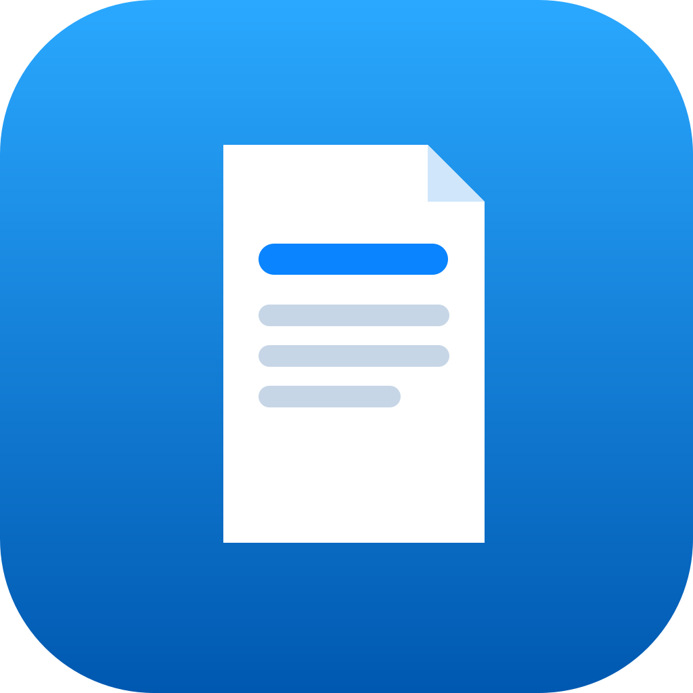
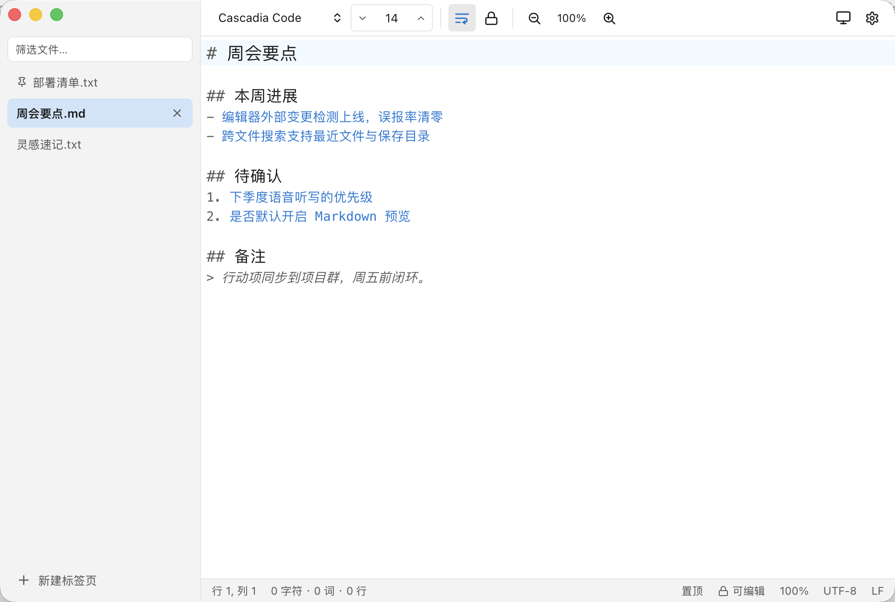

  

<h1 align="center">Jotpad</h1>

  <strong>快到没有存在感的跨平台文本记事本</strong> 
  macOS · Windows · Linux ｜ 无账号 · 无订阅 · 无云端

  <a href="https://github.com/ZturnLibs/jotpad/releases/latest">📥 免费下载</a> ·
  <a href="https://github.com/ZturnLibs/jotpad/releases">📦 全部版本</a>

  

---

## 这些瞬间，你是不是也经历过

- 🧾 打开多年前的老文档，满屏乱码和问号
- 🐢 只想记一句话，IDE 却转了半分钟启动动画
- 💨 手一滑关掉窗口，刚敲的字全没了
- 🔐 记个笔记，还得先登录、联网、接受会员协议
- 🤖 文件被别的程序改了，编辑器要么毫无反应，要么反复弹窗骚扰

**Jotpad 就是来解决这些的。** 它比系统记事本强得多，又比 IDE / 云笔记轻得多——打开就能写，写完不用管。

## 为什么用过的人回不去了

### ⚡ 秒开，一敲字就响应
原生内核（非 Electron），Windows / macOS 安装包只有约 6MB，启动即输入。它快到你意识不到「开了个软件」，只觉得多了张纸。

### 🗂 多标签 + 会话，工作现场永不散场
像浏览器一样开一堆标签；左侧文件列表常驻，常用文件一键置顶。关掉再打开，上次的标签、光标位置、滚动位置原样奉还；「昨天那组文件」存成命名会话，今天一键回来。

### 🔤 乱码克星
UTF-8 / GBK / Big5 / Shift-JIS / EUC-KR / UTF-16 / Windows-1252 全支持，打开自动检测编码，另存时可任意转换。Windows 同事发来的文件、十年前的老档案，打开都是人话。行尾 CRLF / LF / CR、BOM 同样一键处理。

### 💾 草稿永不丢，历史随时回
写下的每个字都在落盘——崩溃、断电、手滑关窗口，重开都在。每次保存自动快照到**本地历史**，误删一段、改错一版，打开历史面板找回。文件被其他程序改动时智能提醒：内容没变不打扰，真变了才问你要不要重新加载，未保存的修改先备进历史再替换，永远不会悄悄吞掉你的字。

### 🔍 你的文件，搜得到、找得快
- **跨文件全文搜索**：在打开的、最近的、保存目录里的所有文件中按内容检索，命中分组高亮、一键跳转
- **快速打开**（`Cmd/Ctrl+P`）：文件名模糊匹配，从未打开过的也能搜到
- **Markdown 大纲**（`Cmd/Ctrl+Shift+O`）：标题树过滤跳转，长文不迷路

### 🔒 文件就是你的文件
存的统统是普通 `.txt` / `.md`，躺在你自己磁盘的目录里。iCloud、Git、U 盘、网盘——想怎么同步怎么同步；哪天不想用 Jotpad 了，任何编辑器都能无缝接管。**没有账号，没有订阅，没有云端，没有锁定。**

## 还有这些顺手的小设计

| | |
| --- | --- |
| **Markdown 增强**（实验特性） | 语法高亮、分栏实时预览、`Cmd/Ctrl+B` 加粗、任务列表样式 |
| **中文友好** | 双击按词选中（分词感知）、中英文界面一键切换 |
| **查找替换** | 正则、区分大小写、匹配计数、逐项跳转 |
| **语音听写** | 本地语音包，开会对着说就能记（无需联网） |
| **大文件保护** | 超大文件自动只读防卡死，也可手动锁定防误改 |
| **桌面集成** | 托盘常驻、全局唤起（`Cmd/Ctrl+Shift+J`）、右键「新建文本文件 / 用 Jotpad 打开」、拖拽开文件 |
| **外观** | 深色 / 浅色 / 跟随系统，自定义强调色、字体字号缩放、行号、自动换行 |
| **杂项利器** | 转到行、插入时间日期、窗口置顶、打印与页面设置、与磁盘版本 diff 对比、自动更新 |

## 下载

前往 [Releases](https://github.com/ZturnLibs/jotpad/releases/latest) 免费获取：

| 系统 | 安装包 |
| --- | --- |
| macOS（Apple Silicon / Intel） | `.dmg`、`.pkg` |
| Windows | `setup.exe`（NSIS）、`.msi` |
| Linux | `.AppImage`、`.deb`、`.rpm` |

安装后应用内自动检查更新，一键升级。

## 快捷键

| 操作 | Windows / Linux | macOS |
| --- | --- | --- |
| 新建标签页 | `Ctrl+N` | `Cmd+N` |
| 打开 | `Ctrl+O` | `Cmd+O` |
| 快速打开 | `Ctrl+P` | `Cmd+P` |
| 保存 | `Ctrl+S` | `Cmd+S` |
| 另存为 | `Ctrl+Shift+S` | `Cmd+Shift+S` |
| 关闭标签页 | `Ctrl+W` | `Cmd+W` |
| 切换标签 | `Ctrl+Tab` / `Ctrl+PageDown/Up` / `Ctrl+1…9` | `Ctrl+Tab` / `Cmd+Option+←/→` / `Cmd+1…9` |
| 查找 / 替换 | `Ctrl+F` / `Ctrl+H` | `Cmd+F` / `Cmd+Option+F` |
| 查找下一个 / 上一个 | `F3` / `Shift+F3` | `F3` / `Shift+F3` |
| 转到行 | `Ctrl+G` | `Cmd+G` |
| 撤销 / 重做 | `Ctrl+Z` / `Ctrl+Y` | `Cmd+Z` / `Cmd+Shift+Z` |
| 窗口置顶 | `Ctrl+Shift+T` | `Cmd+Shift+T` |
| 插入时间/日期 | `F5` | `F5` |
| 放大 / 缩小 / 重置 | `Ctrl+=` / `Ctrl+-` / `Ctrl+0` | `Cmd+=` / `Cmd+-` / `Cmd+0` |
| 设置 | `Ctrl+,` | `Cmd+,` |
| 关闭面板 | `Esc` | `Esc` |

## 数据在哪里

草稿、设置与本地历史都保存在本机应用数据目录，不上传任何服务器：

- macOS: `~/Library/Application Support/com.jotpad.app/`
- Linux: `~/.local/share/com.jotpad.app/`
- Windows: `%APPDATA%\com.jotpad.app\`

## 便携版与企业部署

**便携版**：在 Jotpad 可执行文件同级目录创建一个名为 `jotpad.portable` 的空文件，所有数据（草稿、设置、历史）即随身存放在程序旁的 `data/` 目录——U 盘即插即用，不留痕迹。

**静默安装**：

- Windows MSI：`msiexec /i Jotpad_<版本>_x64_zh-CN.msi /qn /norestart`
- Windows NSIS：`Jotpad_<版本>_x64-setup.exe /S`
- macOS：`.pkg` 可经 MDM（如 Jamf）分发，或 `sudo installer -pkg Jotpad.pkg -target /`
- Linux：`sudo dpkg -i Jotpad_<版本>_amd64.deb`，或直接运行 AppImage

---

开发指南与发布流程见 [DEVELOPMENT.md](DEVELOPMENT.md) ｜ 设计决策 [DECISIONS.md](DECISIONS.md) ｜ 路线图 [ROADMAP.md](ROADMAP.md)
